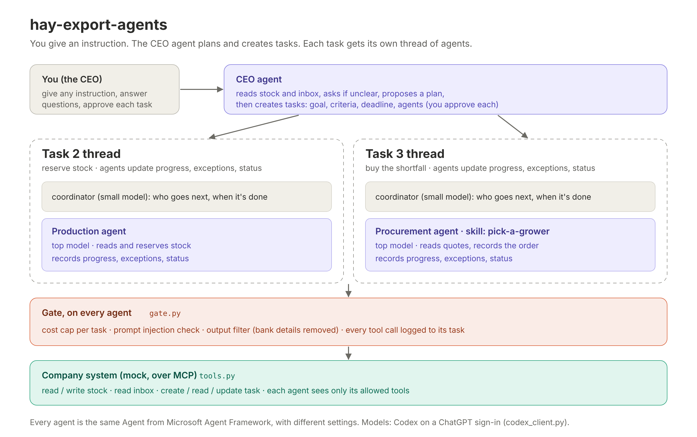

# hay-export-agents

A small proof of concept: AI agents for an oaten hay exporter, on **Microsoft Agent Framework**.
You give an instruction, the CEO agent plans and creates tasks, and each task gets its own
thread of agents that works until it's done. All data is synthetic.



## Run it

```bash
pip install -e ".[dev]"
codex login                       # once; your ChatGPT sign-in, no API key
pytest -q                         # no model needed

python -m hayagents.tools reset   # fresh data
python -m hayagents.web           # then open http://localhost:8000
python -m hayagents.team          # or in the terminal, e.g. "Saigon Dairy needs 500 t of hay, moisture at most 13%, by 15 Dec."
```

## How it works

- **Web page (`web.py`, `web.html`):** give an instruction, approve the plan, watch each task's agents
  work live (tool calls shown as they happen), and see the stock and inbox change on the right.
- **CEO agent:** reads stock and the inbox, asks you if something is unclear, and proposes its plan as
  tasks (goal, completion criteria, deadline, agents). Nothing starts until you approve.
- **Task thread:** each new task runs its agents together, with a small coordinator model, until done.
  Agents record progress and exceptions on the task and set it done.
- **Same agent everywhere:** every agent is built by one function; only its row in `AGENTS` differs.
- **Models:** the CEO and department agents run on the top model; the coordinator on a small one.
- **MCP:** the company system (`tools.py`) is a separate MCP server. Each agent connects with
  `allowed_tools` set to its row, which is its permission. At Balco this would be Business Central's
  MCP server instead.
- **Gate (`gate.py`):** on every agent: cost cap per task, prompt injection check, output filter
  (bank details removed), and a log of every tool call on its task.
