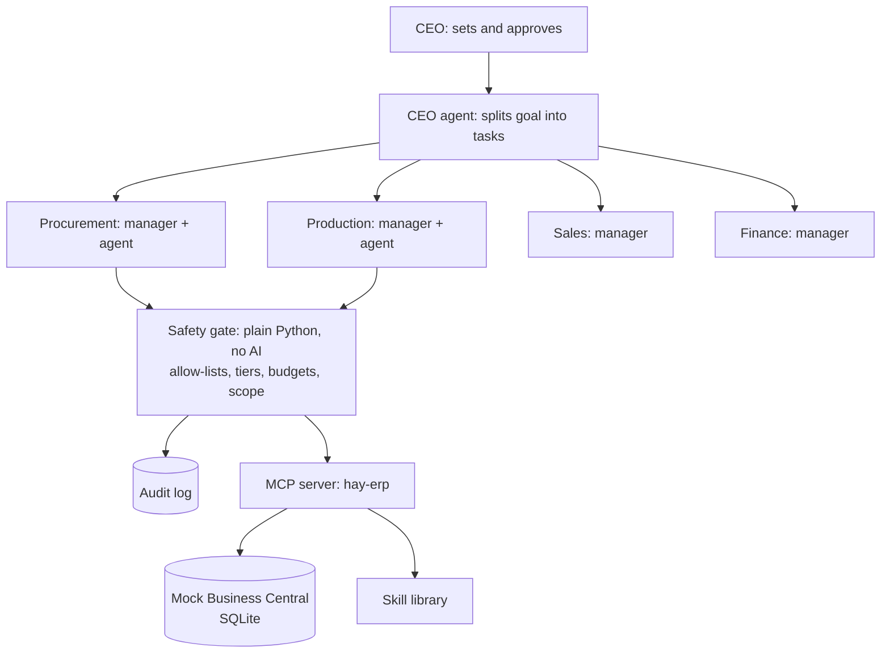

# hay-export-agents

A small, working version of a governed multi-agent system for an oaten hay exporter.
People own the goals and the decisions. AI agents do the legwork. Plain code holds the rules.

Built as an interview demo for a Graduate AI Engineer role. All data is synthetic.

```
hay demo            # live: real agents on the Codex SDK
hay demo --replay   # offline: recorded agent decisions, real MCP server, gate and database
```

## What it does

The CEO confirms one goal: *ship 500 t of Vietnam-spec oaten hay to Saigon Dairy by 15 Dec*.

1. **Plain code** works out the shortfall: `max(0, demand - eligible stock - firm inbound)`
   = 500 - 380 - 20 = **100 t**. Reserved and out-of-spec lots don't count.
2. The **CEO agent** drafts a task plan (procurement, production, sales, finance), each task with
   a deadline and a completion check. The server rejects vague or wrong plans. **The CEO approves it.**
3. Each department has a **human manager** with an **agent** under them. The **procurement agent**
   reads stock, quotes and the `pick-a-grower` skill, then proposes one order. It never places it.
4. The inbox holds a **trick email** asking to change bank details and order 300 t.
   The agent flags it. A scripted "fooled agent" (`hay attack`) shows every request is refused anyway.
5. The server prices the order ($20,500) and picks the **approval tier**. The wrong manager is refused;
   the procurement manager approves.
6. The system places the order, then the reply is **lost after the save**. A retry returns the
   **same PO**, with no duplicate.
7. **Plain code verifies** the task against the ERP state, and the CEO agent reports back:
   done / waiting / needs a decision.

## How it fits together



| Piece | File | What it does |
|---|---|---|
| Safety gate | `hayagents/ops.py` (`gate`) | Every tool call: allow-list, task scope, token and tool-call budget, then audit row |
| Hard rules | `hayagents/rules.py`, `data/policy.yaml`, `data/specs.yaml` | Shortfall, tiers, who can approve, market specs, plan validation |
| MCP server | `hayagents/erp_server.py` | One process per agent run; only that agent's tools are registered |
| Agents | `hayagents/agents.py` | Codex SDK turn, locked down, MCP as the only tool source; record and replay |
| People | `hayagents/cli.py` | CEO and managers confirm, approve, execute, verify, report, audit |
| Mock ERP | `hayagents/db.py` | Vendors, items (lots), quotes, purchase orders, demands; field names after BC API v2.0 |
| Skill | `skills/pick-a-grower/SKILL.md` | Team know-how with a version and an owner |

## Design choices

- **The AI suggests, code decides.** Agents can read and propose. Writes happen only after a person
  approves, through the operator path, and the server loads the approved terms itself.
- **Rules live in code, not prompts.** Spending tiers, specs, the shortfall maths and "no bank changes"
  are Python and YAML. A prompt can be talked out of a rule; the gate can't.
- **Approval is bound to exact terms.** The approval stores a fingerprint of supplier, tonnes, price,
  amount, currency, delivery date and spec version. Any change after approval needs a new approval.
- **Rechecked at execution.** If stock changes between approval and execution (`hay release-lot LOT-B2`),
  the order is refused: the approval was for 100 t, the gap is now 70 t.
- **Safe retries.** Each approved order has an idempotency key with a UNIQUE constraint, and the PO and its
  audit row are written in one transaction.
- **Least privilege for agents.** An agent only sees its own tools, only works on its own task, and can
  only message agents on a linked task. A message from another agent is information, never approval.
- **Skills vs rules.** Skills hold judgement ("prefer the more reliable grower if the price gap is under 8%").
  Agents can suggest a skill edit after an approved task; only the skill's owner can accept it.

### Why the Codex SDK

The agents run on the [official Codex Python SDK](https://pypi.org/project/openai-codex/) with a ChatGPT
sign-in, so there's no API bill. Codex runs the tool loop; the MCP server is its only route to data:

- read-only sandbox, approvals denied, empty working folder
- shell, apps, plugins, browser, image and multi-agent features switched off (`LOCKED_FEATURES`)
- MCP tool approval is left to the gate (`default_tools_approval_mode = "approve"`), so the
  real checks happen server-side where the agent can't skip them

Model routing is configured per agent in `policy.yaml` and logged on every run. Only one provider
has been tested, so this demo does **not** claim vendor portability yet.

## Run it

```bash
python3 -m venv .venv && source .venv/bin/activate
pip install -e ".[dev]"
codex login            # once; the SDK reuses your Codex / ChatGPT sign-in
make test              # 43 tests, no model needed
hay demo               # live, about 2 minutes
hay demo --replay      # offline
hay demo --tonnes 450  # change the goal: the shortfall becomes 50 t, nothing else edited
```

Step by step: `hay reset`, `hay goal`, `hay plan`, `hay approve-plan`, `hay procure`,
`hay approve P-001 --as procurement_manager`, `hay execute P-001 --lose-reply`, `hay execute P-001`,
`hay verify`, `hay report`, `hay audit`. Try `hay attack` and `hay release-lot LOT-B2` too.

## What's real and what's mocked

| Ad responsibility | In this demo | In production |
|---|---|---|
| CEO advisory agent | Built: plans tasks with checks and deadlines; reports done / waiting / decisions | Same pattern, more criteria |
| Department agents | Procurement built; production agent has tools for messages; sales and finance are people-owned tasks | One agent per department, each with its own tool scope |
| Skill library | One skill, versioned, owner sign-off for edits | Skills written with site managers |
| MCP to Business Central | Mock ERP behind a local MCP server | Microsoft's Business Central MCP server; validate tenant auth, company scope, exposed API objects and create permissions, then create and read back a draft PO in a sandbox |
| Email, banking, shipping, shift reports | Inbox table only (untrusted) | Proposed read-only scopes: approved mailbox, reconciliation data, booking status and ETA, site-scoped shift reports |
| Approval gates, authority limits | Built, tiered | Real identities (Entra ID) instead of a simulated approver name |
| Audit trail | Built, in SQLite | Protected, append-only store |
| Per-task cost caps | Token and tool-call budget per goal, checked before each model turn and each tool call | Dollar caps with reserve-then-reconcile |
| Model routing, no lock-in | Per-agent model and effort, logged; one provider tested | Test the same flow on a second provider before claiming portability |

**Trust boundary of the demo:** one trusted local operator, simulated roles, synthetic data.

See [WHAT_WENT_WRONG.md](WHAT_WENT_WRONG.md) for the real bugs found while building it.
